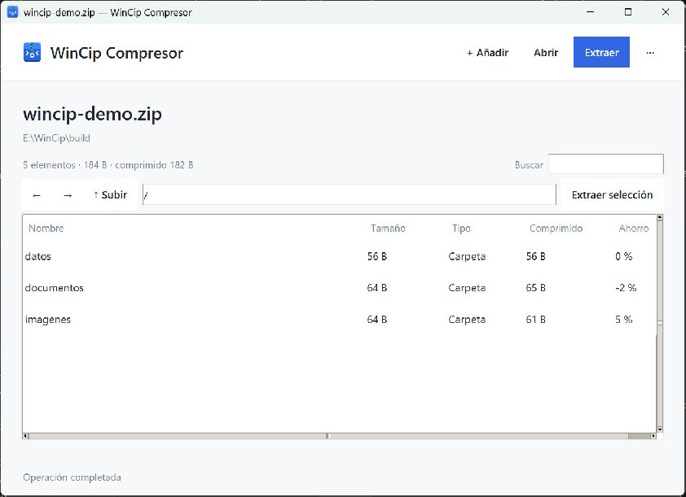

# WinCip Compresor 3.2.0

Aplicación de escritorio para Windows 10 y 11 x64. Explora, crea y extrae comprimidos en el equipo, con instalador y versión portable. Incluye el motor de 7-Zip.

[Instalador x64](https://github.com/ciromunive-dev/WinCip-Compresor/releases/download/v3.2.0/WinCip-Compresor-3.2.0-Setup.exe) · [Portable](https://github.com/ciromunive-dev/WinCip-Compresor/releases/download/v3.2.0/WinCip-Compresor-3.2.0-Portable.zip) · [Publicaciones](https://github.com/ciromunive-dev/WinCip-Compresor/releases)



## Diseño

La interfaz Tkinter ejecuta las operaciones en segundo plano. `archive_formats.py` centraliza las capacidades de cada formato; `archive_policy.py`, los límites de recursos. `archive_core.py` valida rutas y entradas. La edición prepara y verifica un archivo nuevo antes de sustituir el original. La [arquitectura](docs/ARQUITECTURA.md) documenta los contratos entre módulos.

La [guía de desarrollo](docs/DESARROLLO.md) cubre la compilación y las pruebas. Los binarios generados quedan fuera del historial Git.

## Primeros pasos

La aplicación y el instalador se probaron en Windows 11. Falta una prueba directa en Windows 10. La extensión opcional del menú moderno funciona solo en Windows 11.

Ejecuta el instalador o extrae el paquete portable y abre `WinCip.exe`. Consulta la [guía de instalación](docs/INSTALACION.md) para la integración con Windows.

1. **Abrir:** pulsa **Abrir**, usa `Ctrl+O` o arrastra un comprimido a la ventana.
2. **Extraer:** pulsa **Extraer** para todo el contenido o selecciona elementos y usa **Extraer selección**.
3. **Crear:** añade archivos o carpetas con **+ Añadir** y pulsa **Crear comprimido**. Elige formato, nivel, filtros y contraseña opcional.
4. **Más acciones:** el menú **···** reúne edición, conversión, verificación, propiedades, preferencias y ayuda.

## Formatos

| Formato | Explorar y extraer | Crear y convertir a | Modificar contenido | Contraseña |
| --- | --- | --- | --- | --- |
| ZIP | Sí | Sí | Sí, archivo único | Leer y crear; AES-256 al crear |
| 7Z | Sí | Sí | Sí, archivo único | Leer y crear; permite ocultar nombres |
| RAR | Sí | Con codificador instalado | Con codificador instalado, archivo único | Leer; crear y cambiar con codificador instalado |
| TAR, TAR.GZ, TAR.BZ2 y TAR.XZ | Sí | Sí | Sí, archivo único | No |
| GZ, BZ2 y XZ individuales | Sí | No | No | No |

También reconoce TGZ, TBZ y TBZ2 y TXZ. Admite conjuntos de volúmenes ZIP, 7Z y RAR compatibles con el motor incluido. Crea volúmenes ZIP y 7Z, y RAR si está instalado su codificador; todas las partes deben permanecer juntas.

## Funciones principales

- Navegación por carpetas internas, historial, búsqueda, ordenación, propiedades y vista previa de texto e imágenes.
- Extracción completa, de una selección o por lotes, con cancelación y opciones para archivos existentes.
- Edición de contenido: añadir, actualizar, renombrar, eliminar y crear carpetas.
- Reconstrucción y verificación antes de sustituir un comprimido editado; respaldo `.bak` activado de forma predeterminada en la interfaz.
- Conversión de formato conservando el original; la contraseña del destino se configura por separado.
- Verificación de lectura, recientes, preferencias y limpieza de las copias temporales.
- Submenú clásico del Explorador para abrir, extraer y comprimir en Windows 10/11; extensión moderna opcional para Windows 11 x64.

**Guardar como…** copia el comprimido completo; para cambiar el formato utiliza **Convertir formato…**. WinCip detecta cambios guardados por un editor externo y ofrece incorporarlos; también comprueba cambios pendientes antes de cerrar o cambiar el comprimido. El menú **···** incluye restauración de respaldos y edición del comentario ZIP.

## Documentación

- [Arquitectura implementada](docs/ARQUITECTURA.md): capas, capacidades, transacciones y edición externa.
- [Historias de usuario y casos de prueba](docs/HISTORIAS_USUARIO.md): acciones disponibles y resultado esperado de cada prueba.
- [Resultados de los 66 casos](docs/RESULTADOS_66_CASOS.md): evidencia obtenida y comprobaciones pendientes por caso.
- [Alcance del producto](ALCANCE.md): funciones, entregables, límites y pendientes reales.
- [Instalación y desinstalación](docs/INSTALACION.md).
- [Guía de uso](docs/USO.md): operaciones, contraseñas, volúmenes, respaldos y atajos.
- [Limitaciones y solución de problemas](docs/LIMITACIONES.md): compatibilidad, datos que se conservan, temporales y errores frecuentes.
- [Desarrollo](docs/DESARROLLO.md): entorno, estructura, compilación, pruebas y extensión del Explorador.
- [Cambios de la versión 3.2.0](CHANGELOG.md).
- [Informe de pruebas](docs/PRUEBAS.md), [revisión de licencias](docs/LICENCIAS.md) y [revisión preliminar del nombre](docs/IDENTIDAD.md).

## Ejecutar desde el código

Desde la raíz del proyecto, con Python 3.11 de 64 bits y Tkinter:

```powershell
py -3.11 -m venv .venv
.\.venv\Scripts\python.exe -m pip install -r requirements.txt
.\.venv\Scripts\python.exe app.py
```

Los archivos `engine/7z.exe` y `engine/7z.dll` deben estar presentes. Las instrucciones completas están en la [guía de desarrollo](docs/DESARROLLO.md).

## Componentes incluidos

Utiliza 7-Zip, de Igor Pavlov, y bibliotecas como tkinterdnd2, pyzipper, pycryptodomex y Pillow. La licencia incluida del motor está en [engine/License.txt](engine/License.txt). El código propio se distribuye bajo [MIT](LICENSE). Las dependencias conservan sus licencias; los textos se incluyen en `licenses/` y en el instalador. Véase [THIRD_PARTY_NOTICES.md](THIRD_PARTY_NOTICES.md).
