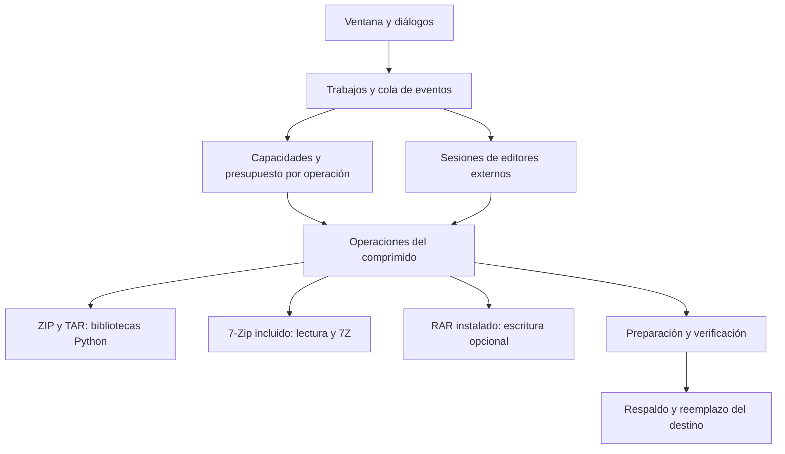

# Arquitectura de WinCip Compresor

Implementación del 22 de octubre de 2026. [Alcance](../ALCANCE.md) · [Desarrollo](DESARROLLO.md) · [Pruebas](PRUEBAS.md).

## Capas y responsabilidades

| Capa | Código | Responsabilidad |
| --- | --- | --- |
| Presentación | `ui.py`, `dialogs.py` | Ventana, menús, campos y diálogos; no escribe directamente el contenido de los comprimidos |
| Aplicación | `app.py`, `features.py`, `workflows.py` | Selección, navegación, preferencias, trabajos, resultados y decisiones del usuario |
| Capacidades | `archive_formats.py` | Formatos de salida, extensiones compuestas, alias, cifrado, volúmenes y disponibilidad de edición |
| Recursos | `archive_policy.py` | Presupuesto por operación mediante `ContextVar`; cero significa sin tope numérico |
| Dominio y almacenamiento | `archive_core.py` | Índice, rutas seguras, creación, extracción, edición, conversión, verificación y restauración |
| Codificador opcional | `rar_backend.py` | Detecta `Rar.exe` instalado y ejecuta creación RAR; no distribuye ese codificador |
| Edición externa | `edit_sessions.py` | Copias de trabajo, huellas SHA-256, detección de cambios, versiones del original y actualización agrupada |
| Temporales | `temporary_files.py` | Carpetas propias, protección entre ventanas, archivos bloqueados y limpieza |
| Carpetas de operación | `workspaces.py` | Propiedad del directorio, reintentos acotados de borrado transitorio y conservación del error de operación |
| Windows | `windows_integration.py`, `shell_extension/` | Asociaciones, COM, menús clásico/moderno y comandos sobre selecciones múltiples |
| Distribución | `build_release.py`, `WinCip.spec`, `installer/` | Recursos, EXE, DLL, avisos de dependencias, instalador, portable, fuente y hashes |

## Contrato de formatos

ZIP, 7Z, TAR, TAR.GZ, TAR.BZ2 y TAR.XZ se crean y editan con los componentes incluidos. Se reconocen los alias `.tgz`, `.tbz`, `.tbz2` y `.txz`. Los nombres de salida conservan el formato elegido, también al editar extensiones compuestas.

RAR se lee con el motor incluido. Su creación, conversión de destino y edición se habilitan al detectar un `Rar.exe` instalado. La detección consulta las carpetas de WinRAR y sus entradas de App Paths; `WINCIP_RAR` permite indicar otra ruta. El codificador trabaja sobre copias preparadas, ignora la configuración externa de RAR y recibe una lista UTF-8 de entradas. Se comprueban su estado de salida y la cancelación. ZIP, 7Z y RAR pueden crearse divididos; la edición directa corresponde a un archivo único. Para modificar un conjunto dividido se convierte primero a un archivo único.

Las capacidades se comparten entre la interfaz y el motor. La ausencia del codificador RAR no deshabilita lectura, extracción ni conversión desde RAR. Los formatos TAR no ofrecen cifrado porque ese contenedor no lo proporciona; el cifrado del destino se elige al convertir a ZIP, 7Z o RAR.

## Trabajo y cancelación

Cada ventana ejecuta un trabajo de archivo a la vez. El trabajo corre fuera del hilo de Tk; comunica progreso, resultado o error por una cola. Los diálogos y cambios de widgets se realizan en el hilo de la ventana. La cancelación se consulta al leer/copiar y mientras se espera un proceso externo; un proceso cancelado se termina y se recoge.

El presupuesto se captura al comenzar el trabajo. El contexto evita que otra ventana o hilo cambie sus límites a mitad de una operación. Los valores iniciales son 100 000 entradas y 50 GiB; ambos se pueden aumentar o poner en cero en Preferencias. Se siguen comprobando rutas, tipos, tamaños declarados frente a bytes reales y espacio disponible. Quitar el presupuesto no elimina esas validaciones.

## Edición, respaldos y restauración

La edición extrae a una carpeta aislada, aplica las modificaciones y genera un resultado nuevo. El original no se reemplaza hasta terminar la verificación y volver a comprobar su versión. Si se solicita un respaldo, se copia el original a un archivo nuevo numerado. La sustitución se realiza mediante `os.replace` en el mismo volumen.

La limpieza de carpetas de operación reintenta fallos transitorios de Windows como archivos temporalmente bloqueados o un directorio aún no vacío. Cada intento vuelve a comprobar que la ruta corresponde al directorio asignado y no a un enlace o sustitución. Los reintentos son acotados; no se ignoran errores permanentes ni se sustituye el error original por otro de limpieza.

La restauración copia el respaldo a una zona de preparación, verifica el contenido y solicita su contraseña si corresponde. Conserva el estado actual en otro respaldo antes de sustituirlo. Un respaldo corrupto, una contraseña incorrecta, una cancelación o un cambio del original impiden el reemplazo. La interfaz permite seleccionar los respaldos del archivo abierto.

Los comentarios del ZIP y de sus entradas, el sistema creador y los atributos de sus entradas se conservan al reconstruir ZIP; el comentario general se puede editar. Los campos adicionales específicos de otros programas y todos los metadatos de otros formatos no se consideran conservados por este contrato. La conversión crea un contenedor nuevo.

Estas transacciones cubren errores manejados y cancelación. No constituyen un diario durable frente a cortes de energía: no se declara una recuperación completa del sistema de archivos después de una interrupción forzada.

## Archivos abiertos en un editor externo

Una copia queda asociada al comprimido, la ruta interna, una versión del original y una huella de su contenido. Volver a abrir el mismo miembro reutiliza su copia. Al recuperar el foco, WinCip comprueba los archivos cuyo estado cambió y ofrece actualizar el comprimido. También existe la acción manual **Actualizar desde editores externos…**.

El guardado prepara instantáneas de las copias y reúne sus sustituciones en una reconstrucción verificada. Si el comprimido cambió desde la apertura, se rechaza la actualización y se conservan las copias. Un guardado posterior del editor mientras se comprime queda pendiente para la siguiente comprobación.

Cerrar la ventana, cerrar el comprimido, cambiarlo o preparar otro archivo comprueba los cambios pendientes. El usuario puede guardarlos, descartarlos o cancelar la salida. Un error al guardar no autoriza limpiar las copias. Las claves permanecen en memoria; no forman parte de preferencias ni de metadatos de la sesión. No se promete recuperar copias después de un cierre forzado del proceso.

## Seguridad de archivos

Las rutas se validan antes de escribir. Se rechazan escapes, rutas absolutas, nombres reservados de Windows, enlaces, puntos de reanálisis y entradas especiales. En lectura mediante 7-Zip se escribe cada entrada sobre un archivo abierto por WinCip; el proceso externo no elige rutas de salida. Las marcas de zona de Internet se propagan cuando el sistema de archivos lo admite.

Los procesos de compresión operan sobre un árbol preparado. Ningún comando recibe una cadena construida para que la interprete un intérprete de órdenes. Las contraseñas usadas por motores externos son argumentos de esos procesos: esto no ofrece aislamiento frente a otros procesos con permisos suficientes.

## Distribución y comprobación

La compilación genera un EXE, DLL, instalador por usuario con desinstalación, portable, fuentes y SHA-256. El instalador conserva archivos ajenos y el desinstalador retira solo los archivos enumerados del producto. El menú clásico funciona sin identidad de paquete. El moderno necesita que Windows acepte el registro de su identidad; su firma pública requiere credenciales de editor que no existen en el repositorio.

La suite comprueba contenido, originales, respaldos, errores, cancelación y cambios concurrentes; `diagnostics.py` repite operaciones dentro del EXE empaquetado. El instalador se valida con un ciclo aislado de instalar, actualizar, ejecutar y desinstalar. El resultado y los sistemas efectivamente probados se registran en [PRUEBAS.md](PRUEBAS.md).
